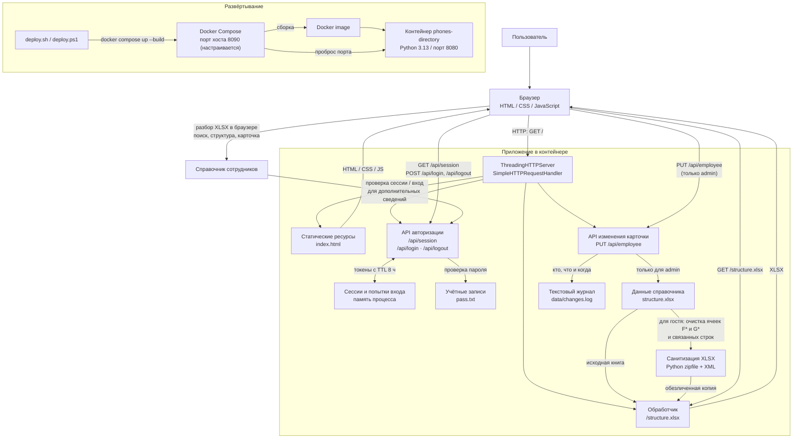

# Архитектура приложения



## Основные потоки

- При открытии страницы сервер отдаёт `index.html`; браузер проверяет сессию и отдельно загружает `structure.xlsx`.
- XLSX разбирается на клиенте. Там же строятся список подразделений, поиск и карточка сотрудника.
- Гостю сервер возвращает копию книги с удалёнными ячейками столбцов F и G первого листа (дата рождения и телефон). После входа возвращается исходная книга.
- Пользователь с логином `admin` может редактировать все поля строки карточки. Сервер проверяет права, обновляет исходный `structure.xlsx` и добавляет запись в `data/changes.log`; журнал не отдаётся по HTTP.
- Docker Compose подключает папку проекта вне веб-корня контейнера; сервер атомарно обновляет в ней исходный `structure.xlsx` и пишет журнал в `data/changes.log`. Правки сохраняются после пересоздания контейнера.
- Успешный вход создаёт серверную сессию в памяти процесса и устанавливает cookie `HttpOnly`; выход удаляет сессию.
- `deploy.sh` (Linux/macOS) и `deploy.ps1` (Windows 10) запускают сборку и контейнер через Docker Compose. Порт хоста по умолчанию `8090`, порт приложения в контейнере — `8080`.

### Запуск в Docker Desktop на Windows 10

1. Запустите Docker Desktop и убедитесь, что Docker Engine доступен.
2. Создайте `pass.txt` в папке проекта: каждая строка должна содержать логин и пароль, разделённые пробелом.
3. Откройте PowerShell в папке проекта и выполните:

   ```powershell
   powershell -NoProfile -ExecutionPolicy Bypass -File .\deploy.ps1
   ```

   Чтобы использовать другой порт хоста, например `8088`, добавьте `-Port 8088`.
4. Откройте выведенный скриптом адрес. Для доступа с других устройств может понадобиться разрешить входящие подключения на выбранный порт в брандмауэре Windows.

## Ограничения текущей архитектуры

- Сессии и лимиты попыток входа хранятся в памяти одного процесса: они сбрасываются при перезапуске и не разделяются между несколькими экземплярами.
- В Docker Compose каталог проекта подключён к серверу для сохранения исходного `structure.xlsx` и журнала `data/changes.log`; подключённый каталог расположен вне веб-корня и не отдаётся статическим сервером. `pass.txt` копируется в образ при сборке.
- Браузер загружает книгу целиком и выполняет её разбор локально; сервер не предоставляет отдельный API для поиска или карточек сотрудников.
